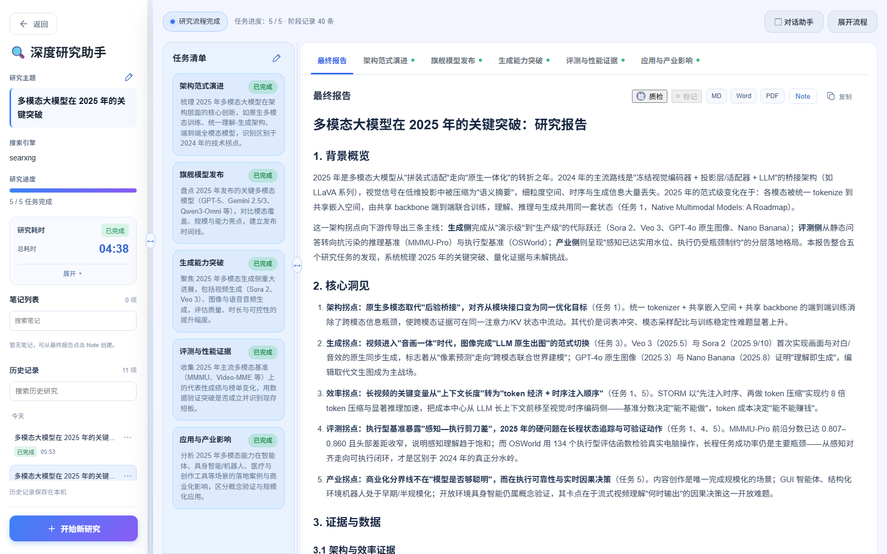
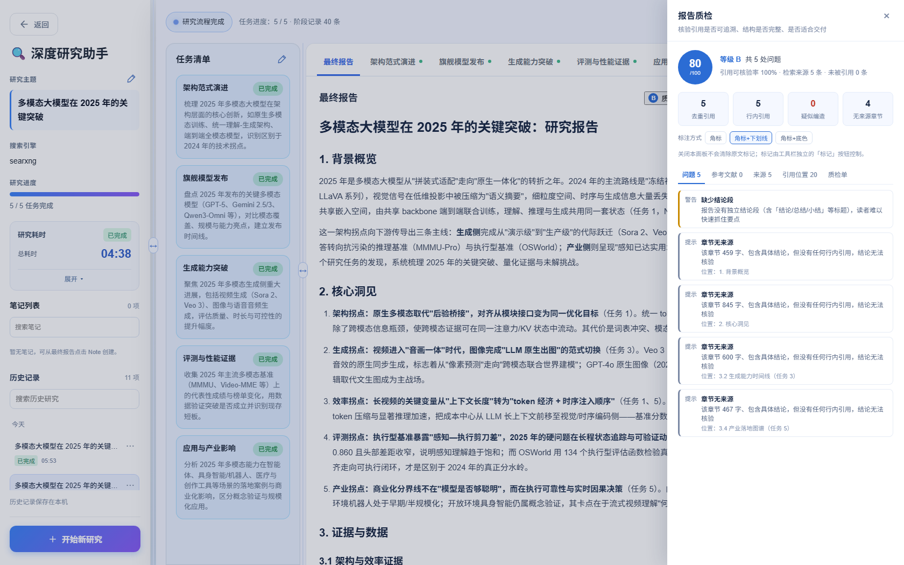
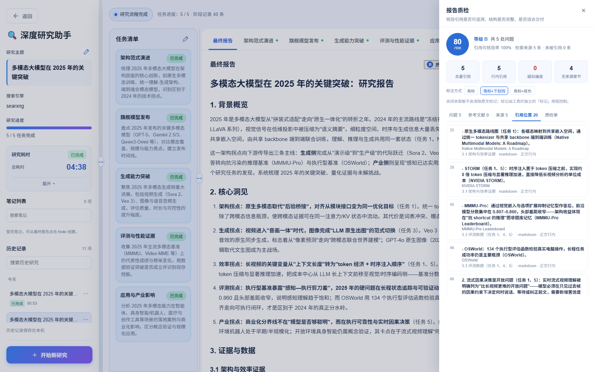
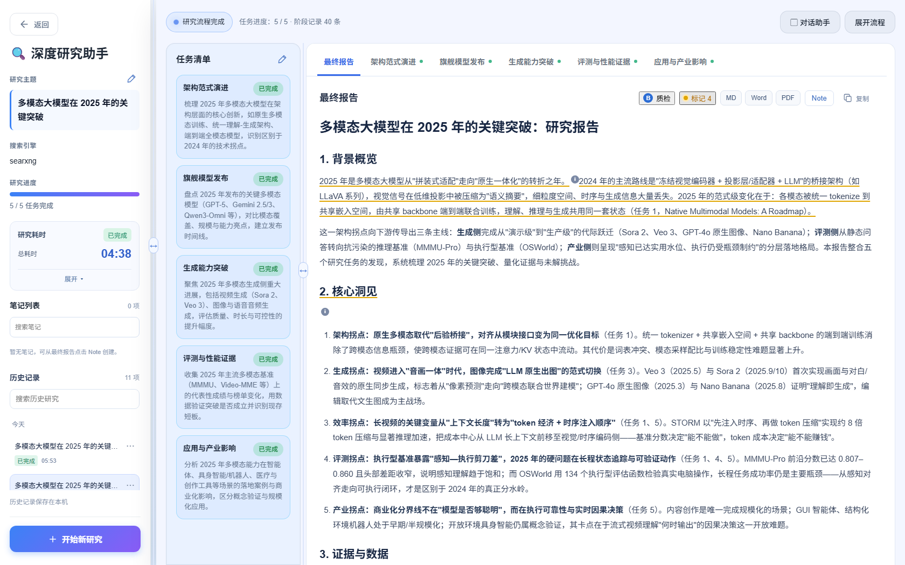
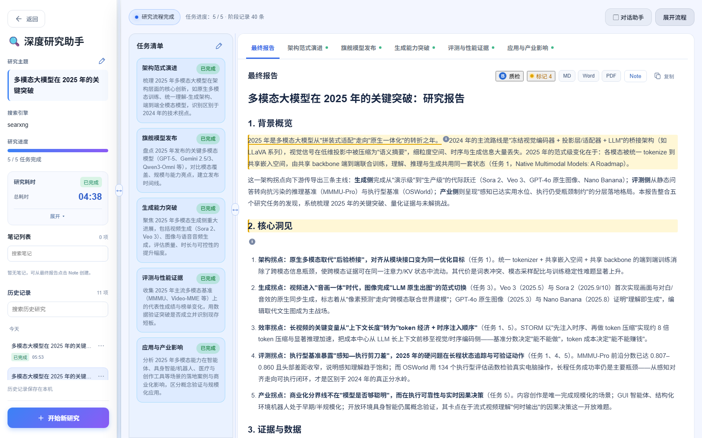
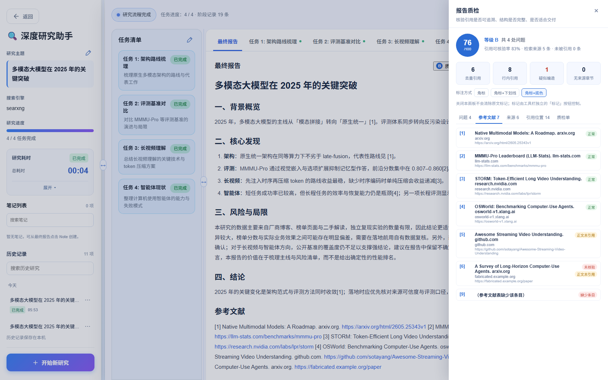
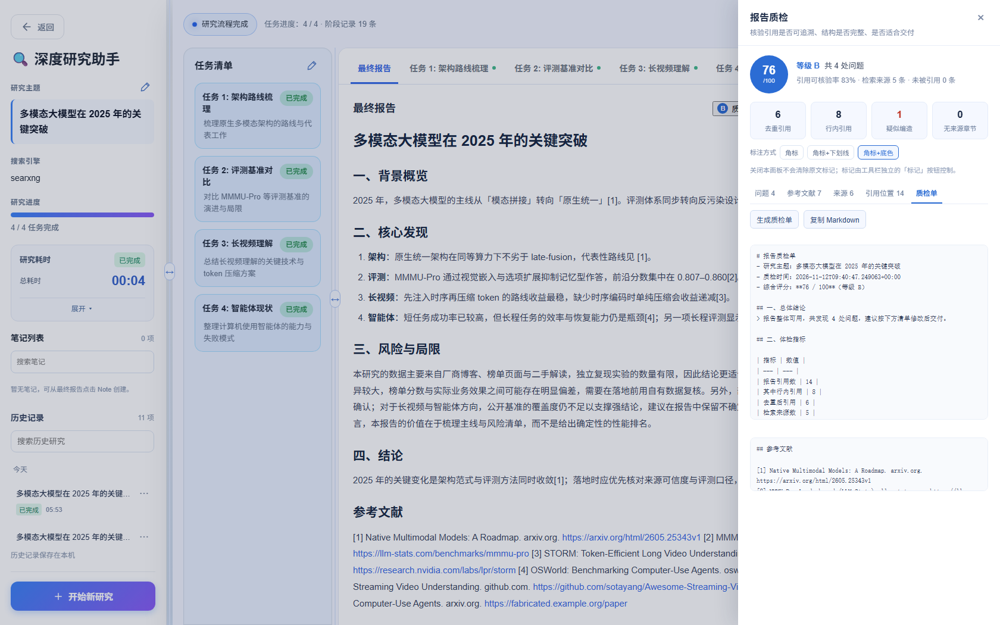
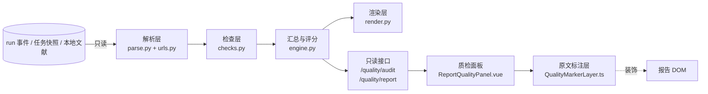

# 报告质检功能（Report Quality Gate）

> 第四人独立功能：在"研究报告生成"之后，增加一道**交付前质检**。
> 只读已有报告与检索记录，不改研究流程、不改导出、不改本地文献库、不改任何人的代码逻辑。

一句话：**自动核验报告里的引用是否真的有来源、哪些结论没有出处、结构是否完整，并生成可附在报告后的质检单与规范参考文献表；问题能在原文里精确标注并跳转。**



---

## 一、为什么需要它

现有产品已经能"研究出报告"，但报告本身**不可核验**：

- 真实报告（实测 `shared-data` 样本）正文几乎没有行内引用，来源全堆在文末列表；
- 报告里的链接是否真的来自本次检索，没有校验，模型可能编造；
- 哪些章节有结论但没出处，读者无法判断；
- 导出的交付物没有质检结论，无法证明"这份报告可以交"。

真实模型（kimi-k3）产出的一份 5561 字研究报告，质检结果是：**评分 80 / B**，5 条引用全部可核验，但有 **4 个长章节没有任何行内引用**、且缺少独立结论段——这些问题人工翻一遍很费时，质检功能一次扫描就能列出来。

---

## 二、快速上手

1. **启动**（与原有方式一致，无需新增依赖）：

   ```powershell
   .\start-local.cmd        # 或按 RUNNING.txt 分别启动前后端
   ```

2. 打开 http://127.0.0.1:5174 ，进入任意一项**已完成**的研究。
3. 报告右上角出现两个新按钮：

   | 按钮 | 作用 |
   |---|---|
   | **质检** | 打开右侧质检面板（评分、问题、参考文献、引用位置、质检单） |
   | **标记** | 在原文里开关问题标注（角标/下划线/底色），与面板互不影响 |



4. 按需切换「标注方式」：`角标` / `角标+下划线` / `角标+底色`，选择会记在浏览器里。

---

## 三、界面详解

### 3.1 质检面板

- 左上角：**综合评分（100 分制）与等级 A/B/C/D**；
- 四张指标卡：去重引用、行内引用、疑似编造、无来源章节；
- 分 tab 查看：问题 / 参考文献 / 来源 / 引用位置 / 质检单；
- 每条问题都可点击 → **跳到原文对应位置**（链接级 → 句子级 → 章节兜底）。

### 3.2 引用位置（逐条可追溯）

列出报告里的每一条引用：编号或行号、所在章节、**原文句子**、是正文行内还是参考文献段。点击即跳到那句话。



### 3.3 原文标记

打开「标记」后，问题会直接标注在报告原文上：

- 引用显示上标 `[n]` 角标；
- 问题显示严重级符号（✕ 错误 / ! 警告 / i 提示）；
- 三种样式可切换，关闭开关后**角标、下划线、包裹节点全部移除，DOM 完全复原**。

| 角标 + 下划线（默认） | 角标 + 底色 |
|---|---|
|  |  |

### 3.4 参考文献核验

把报告里的**全部参考文献**列出来并标注状态：正常 / 未核验（疑似编造）/ 正文未引用 / 缺少条目。缺条目的编号会额外列出并跳回正文引用位置。



### 3.5 质检单（可直接附在报告后）

一键生成 Markdown 质检单：总体结论、体检指标、**参考文献核验表**、问题清单、交付建议；可复制，也可作为交付材料附在报告后。



---

## 四、质检在查什么

| 类别 | 检查项 | 级别 |
|---|---|---|
| 引用与来源 | 疑似编造/未核验链接（报告有、检索结果里没有） | 错误 |
| | 本地文献已被删除 | 错误 |
| | 检索到了但报告没引用 | 提示 |
| | 同一链接在正文重复引用 | 警告 |
| 编号引用 | 正文 `[n]` 在参考文献表中不存在 | 错误 |
| | 参考文献表有 `[n]` 但正文从未引用 | 提示 |
| 结构完整 | 缺少结论段 / 缺少局限说明 | 警告 / 提示 |
| | 空章节（只有标题没有内容） | 警告 |
| | 标题层级跳跃 / 报告过短 | 提示 / 警告 |
| 来源质量 | 来源过少、单一域名占比过高、任务零来源、只有本地来源 | 警告 / 提示 |
| 覆盖 | 长章节（≥400 字）含具体结论却无行内引用 | 提示 |
| 交付规范 | 缺参考文献段 / 参考文献段为空 / 链接写法不统一 | 提示 / 警告 |

> 特意做了**降噪**：报告只有文末来源列表时只报一条"全文无行内引用"；多个任务各自列同一来源不算重复引用；父章节（内容在子章节）不算空章节；正文链接 + 文末列表不算写法不统一。

---

## 五、评分规则

- 100 分制，按问题类型固定扣分并有上限（例如"疑似编造"单条 12 分、最多扣 36 分）；
- 等级：**A ≥90，B ≥75，C ≥60，D <60**；
- 评分只用于快速判断，具体原因看问题清单，避免"黑箱"。

---

## 六、实现说明



- **后端**：`backend/src/quality/` 纯函数（解析、URL 归一化、检查、评分、渲染）＋ `quality_api.py` 只读接口；
- **前端**：`ReportQualityPanel.vue`（面板）、`QualityMarkerLayer.ts`（只读 DOM 标注层）、`services/quality.ts`；
- **不写数据库、不调模型、不联网**，审计前后事件数不变（有测试断言）；
- 支持四种引用形态：markdown 链接、`- 标题 — URL` 来源行、裸 URL、`[n]` 编号引用 + 编号参考文献表。

### 改动范围（不侵害他人代码）

| 类型 | 内容 |
|---|---|
| 新增 | `backend/src/quality/`（6 个文件）、`backend/src/quality_api.py`、测试 5 个文件、前端 3 个文件、`tools/demo/` |
| 修改 | `backend/src/main.py` **+2 行**（注册路由）、`frontend/src/components/ResearchDocument.vue` **+2 行**（入口组件） |
| 不碰 | `storage.py`、`agent.py`、`planner.py`、`reporter.py`、`summarizer.py`、`search.py`、`export_api.py`、`document_api.py`、`document_library.py`、`MarkdownDocument.vue`、`App.vue` |

### 接口

```
GET  /quality/audit/{run_id}
  → { metrics, score, grade, issues[], sources[], citations[], references[] }

POST /quality/report
  body: { run_id, style: "plain" | "gbt7714-lite", include_uncited }
  → { markdown, references_markdown, score, grade }
```

---

## 七、测试与验收

| 项 | 结果 |
|---|---|
| 后端测试 | **167 项全绿**（原有 97 + 质检 63 + 消息清洗 7） |
| 前端构建 | `vue-tsc --noEmit && vite build` 通过 |
| 真实报告 | kimi-k3 产出的 5561 字报告：评分 80 / B，5 条引用全部可核验，列出 4 个无来源章节与缺少结论段 |
| 只读性 | 审计前后事件数不变（单测断言） |
| 幂等性 | 同一 run 连续审计结果一致（时间戳除外） |

---

## 八、已知限制

- **编号引用依赖报告生成端**：现有真实报告多为"每任务末尾来源列表"，此时编号相关能力不会触发，只能做来源核验与结构检查；要让 `[n]` 生效，需要报告生成提示词产出编号引用（属于研究生成模块，需团队决定）。
- **未做链接可达性检查**（HEAD 探测），避免国内网络误报。
- **原文标注是只读装饰**：依赖报告 DOM 结构（标题/段落/链接），不修改报告内容。
- `tools/demo/` 内的 mock 模型与 mock 搜索**仅用于确定性演示**，不是产品运行路径；正式使用请将 `.env` 的 `SEARCH_API` 设为 `duckduckgo` 或 Tavily，并配置真实模型。

---

## 九、分支与提交

| 分支 / 标签 | 说明 |
|---|---|
| `main` / `vendor/lpc-2026-11-12` | 吕鹏程仓库的原始代码（未改动） |
| `fix/env-blockers` | 让项目能跑起来的环境兼容补丁（temperature、消息清洗） |
| `feat/report-quality-gate` | 质检功能实现（全部提交在此） |
| `lpc-baseline` / `v0.1-quality-gate` | 基线标签 / 首版功能标签 |

提交按里程碑组织：引擎 → 接口 → 前端面板 → 演示工具 → 行内引用语义 → 编号引用与角标 → 参考文献清单 → 真实报告误报修正。

---

## 十、组内同步说明（可直接转发）

> 我这次给深度研究助手加了一个**独立的"报告质检"模块**：报告生成完之后，可以一键核验报告里的链接是否真的来自本次检索（能抓出模型编造的链接）、哪些长章节有结论却没有出处、结构和参考文献是否齐全，并给出 100 分制评分和一份可直接附在报告后的质检单。界面上在报告右上角多了「质检」和「标记」两个按钮：质检面板可以看指标/问题/参考文献/引用位置（每条都能点着跳到原文对应那句话），「标记」能把问题以 `[n]` 角标或下划线的形式标在报告原文里，随时开关、不影响报告内容。功能完全独立：没有改动研究流程、导出和本地文献的任何逻辑，只新增模块并在入口处接了 2 行代码；后端 167 项测试全绿，用真实模型（kimi-k3）产出的报告实测评分为 80/B，能正确列出 4 个无来源章节并定位到具体句子。
